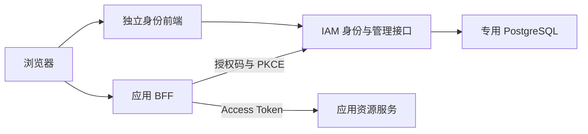

# 架构说明

IAM 面向单个组织及其自有应用，提供身份认证、应用级授权、会话和安全审计。业务操作及对象归属校验由接入应用执行。

## 系统与信任边界

身份前端与 IAM 使用同源 HTTPS，负责登录和管理交互。业务应用通过 OIDC 将用户导航到 IAM 的身份前端，不接收用户的 IAM 密码。BFF 保存协议凭据并建立自己的应用会话，资源服务验证访问令牌并执行业务授权。

身份前端和后端可以独立部署，但浏览器访问使用同一固定 origin。入口到 IAM 可使用经过验证的 HTTPS，或在受保护内网使用显式受信的 HTTP 回源；不开放跨源凭据访问。

## 代码组织

源码位于 `com.ixayda.iam`，按技术职责分包：

| 包 | 职责 |
| --- | --- |
| `controller` | 请求绑定和响应 |
| `dto` | HTTP 传输数据 |
| `security` | Spring Security 认证、会话及请求防护适配 |
| `cli` | 不监听 HTTP 的离线维护入口 |
| `service` | 组织用例、事务和业务校验 |
| `repository` | SQL、锁、持久化及数据库约束适配 |
| `model` | 领域值与状态，不依赖 Spring 或数据库 API |
| `credential` | 密码策略、凭据摘要及秘密处理 |

控制器、安全适配器及 CLI 调用服务，服务通过仓储访问数据库；凭据组件供服务和仓储使用。模型不反向调用服务。依赖规则及顶层类型之间的循环检查由 [ArchitectureTests](../src/test/java/com/ixayda/iam/ArchitectureTests.java)约束。

离线维护仍通过应用服务执行校验与审计。部署维护身份和浏览器用户权限分别控制，持有维护连接不等于建立了管理员浏览器会话。

## 身份认证与管理资格

用户以不可变 UUID 标识，显示名和账号资料不承担授权标识的职责。本地账号设置密码时执行密码策略和弱密码检查，登录时验证已有密码摘要。

IAM 会话持久化到专用数据库，浏览器仅持有受保护的会话 Cookie。HTTPS、CSRF 与服务端会话校验共同保护浏览器入口；前端显示状态不构成授权依据。

IAM 管理员资格、有效密码会话及管理员 MFA 是不同条件。普通用户拥有 TOTP 或应用角色都不能获得管理资格；敏感写操作还需本次新的动态码。TOTP 执行时间窗、重放和尝试预算控制，仍存在钓鱼风险。

恢复码只在签发时展示并单次消费，不能代替管理员敏感操作所需的动态码。开通、密码恢复及因素恢复使用各自用途的单次证明；准备操作不代表认证、凭据替换或权限授予已经完成。

## 应用授权模型

资源以不可变 UUID 标识，并定义应用访问的目标 audience。角色属于一个资源，用户通过直接绑定获得资源角色；绑定保留用户、资源和角色的归属约束，不接受跨资源匹配。

保密客户端关联资源、精确回调、允许 scope 和角色集。客户端秘密保留在应用服务端，查询不能取回原文；轮换及配置版本用于废止旧访问条件。IAM 管理资格独立于资源角色，角色的具体业务含义由应用定义。

IAM 浏览器会话、应用授权与刷新家族、应用本地会话分别存在。结束其中一项不代表其他项已经结束，接入应用需按实际作用范围处理退出和撤销。

## 凭据与签名保护

| 材料 | 存储与保护方式 |
| --- | --- |
| 本地密码 | 带随机盐的 Argon2id 摘要 |
| TOTP 秘密 | 加密持久化，使用独立外部保护文件 |
| MFA 恢复码 | 只保存摘要，原文不持久化 |
| 签名身份 | RSA 3072 / RS256；私钥经 AES-GCM 加密存入数据库 |
| 协议授权状态 | 使用独立保护文件加密并进行完整性保护 |

签名身份跨重启保持原密钥和标识，Web 运行身份只加载既有材料，不能初始化或替换密钥。保护文件与数据库共同构成可恢复的秘密状态，需要分别保管并协同备份，不能作为临时缓存重新生成。

协议状态的数据库可查询投影不独立构成有效证明；使用时核对受保护状态和绑定关系。这使查询、清理所需的投影与实际授权依据保持区分。

## 在线校验与撤销窗口

资源在验签后使用独立校验凭据查询当前授权状态，并将结果与 Token 绑定；该凭据不能兑换授权码或刷新令牌。在线依赖故障时拒绝操作，不自动降级为离线放行。

纯离线验签不能即时获知撤销，300 秒 Access Token 加最多 30 秒时钟偏差可能留下 330 秒窗口。在线正缓存也有相应撤销窗口，失陷密钥还需要接入应用独立更新与拒绝。具体接入流程见 [接入指南](integration.md)。

## 事务与审计

关键成功审计与对应安全状态在同一事务中提交；必要审计失败时，操作失败并回滚。审计保存主体、动作、结果和关联标识，不保存密码或秘密原文。

数据库事件证明技术事务已提交，不能证明组织已核验本人或秘密已送达。人工批准与交付记录独立保管；提交后的展示或通知失败按已提交状态处理，不通过重复安全操作恢复通知。

## 数据库权限与运行模型

维护账号拥有专用数据库，用于迁移和离线维护；Web 进程使用受限运行账号，不持有维护密码。运行权限由 [显式授权清单](../deploy/postgresql/grant-runtime.sql)交付，新表不自动获得授权。`runtime` profile 关闭启动迁移，并在监听前拒绝不合规的数据库身份和权限。

存活探针表达进程状态，就绪探针表达数据库、必要审计和签发能力。这使依赖故障的实例可以撤出业务流量，同时保持存活以便定位原因；故障处理见 [运维指南](operations.md#健康检查与故障定位)。
